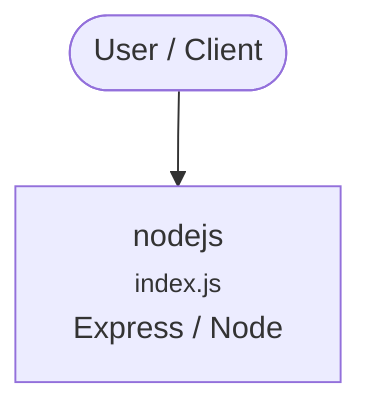

# Context Map — `nodejs`

> Auto-generated architecture & deployment context map. Summarizes the core application, container/cloud footprint, and database connections. Regenerate after significant structural changes.

**Repo:** `avnit/nodejs` · **Original** · Public · Primary language: JavaScript · Default branch: `master` · Files: 16

## 1. Core application

- **Frameworks / runtime:** Express / Node
- **Entry points:** `TestProject/src/client/index.js`, `TestProject/src/server/index.js`, `TestProject/src/server/users/index.js`
- **Listens on port(s):** 3000

## 2. Containers & cloud applications

_No container, Kubernetes, IaC, or cloud-deploy manifests detected. Runs as a local script/library or static site._

## 3. Database connections

_No database drivers or connection strings detected._

## 4. Architecture diagram

## 5. Security posture

- **Dependabot alerts (open):** 10 critical, 43 high, 32 medium, 15 low

---
_Generated by repo context-mapping pass on 2026-08-13._